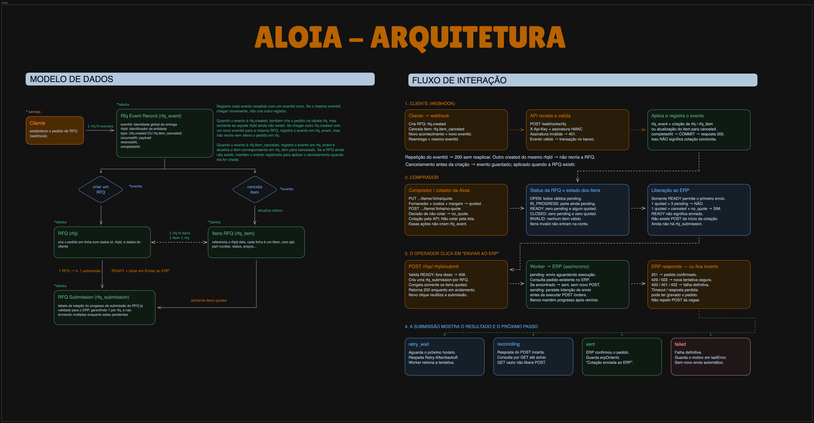

# Desafio técnico ALOIA

Desenvolvimento do desafio técnico para a ALOIA. Registrei os passos que segui [neste documento](docs/passos_desafio.md) e representei visualmente a arquitetura e os fluxos do sistema no diagrama abaixo, buscando compreender melhor as problemáticas e orientar a implementação.



A [SPEC.md](SPEC.md) original permanece como referência do desafio proposto pelo Leobaldo. A [spec viva](specs/001-aloia-rfq-reliability/spec.md) registra o escopo adicional e as decisões que adicionei à implementação. O [AGENT.md](AGENT.md) reúne as instruções e os critérios de validação usados para orientar o agente durante o desenvolvimento.

## O que foi implementado

- Cancelamento de itens por webhook, inclusive quando chega antes da criação do RFQ.
- Idempotência por `eventId` e primeira criação por `rfqId`, também em chamadas concorrentes.
- Envio ao ERP apenas de RFQs `READY`, com os itens `quoted` e uma única submissão por RFQ.
- Tratamento de falhas do ERP, novas tentativas seguras e consulta de pedidos com resultado incerto.
- Situação do envio no detalhe, botão **Enviar ao ERP**, carregamento, erros e atualização automática da tela.
- Filtros por cliente, RFQ e situação, ordenação e consulta manual com confirmação de atualização.
- Testes de idempotência, concorrência, regras de negócio e falhas de integração.

A aplicação mantém NestJS, TypeORM/PostgreSQL, React, Vite e TanStack Query.

## Como rodar

Requisitos: Node.js 22+, npm e Docker com Compose v2. Na raiz do projeto:

```bash
# Na primeira configuração; preserve um .env existente.
cp .env.example .env
npm ci
npm --prefix web ci
```

No `.env`, ajuste `DATABASE_URL` e as variáveis `POSTGRES_*` para o mesmo banco. Defina `INTERNAL_API_KEY`, `WEBHOOK_SECRET` e `ERP_API_TOKEN`; este último é compartilhado com o ERP simulado. Mantenha `ERP_MODE=chaos` para testar as falhas previstas no desafio.

```bash
docker compose up -d --wait
npm run start:dev
```

Em outro terminal:

```bash
npm --prefix web run dev
```

Abra [http://localhost:5173](http://localhost:5173). Por padrão, a API usa a porta `3000` e o ERP, `4000`. Se a porta do ERP estiver ocupada, defina `ERP_PORT=4001` e `ERP_BASE_URL=http://localhost:4001` no `.env` antes de iniciar o Compose.

O ambiente é local: o proxy do Vite injeta a chave da API sem expô-la no navegador, mas não substitui autenticação de usuários. O ERP simulado guarda pedidos em memória; reiniciá-lo perde esse histórico.

### Como testar

Com `DEMO_MODE=true` (padrão do `.env.example`), a API prepara seis exemplos locais ao iniciar, sem enviar pedidos ao ERP:

| RFQ | Situação inicial | Envio permitido |
| --- | --- | --- |
| `RFQ-DEMO-OPEN` | Dois itens pendentes. | Não |
| `RFQ-DEMO-PARTIAL` | Um cotado e três pendentes. | Não |
| `RFQ-DEMO-READY` | Dois cotados. | Sim, dois itens |
| `RFQ-DEMO-MIXED` | Um cotado, um cancelado e um não cotar. | Sim, só o cotado |
| `RFQ-DEMO-CLOSED` | Nenhum item cotável. | Não |
| `RFQ-DEMO-INVALID` | Dois itens inválidos. | Não |

Filtre por `RFQ-DEMO` e abra READY ou MIXED pela ação de visualizar. Clique em **Enviar ao ERP** e acompanhe o resultado; **Consultar situação** atualiza o detalhe manualmente. “Cotação enviada ao ERP” aparece somente após confirmação. Em modo `chaos`, podem ocorrer esperas e falhas.

Reiniciar preserva os exemplos e seus envios. Para outra rodada, use `DEMO_MODE=true DEMO_ROUND=2 npm run start:dev`; os IDs recebem o sufixo `-2`. A preparação fica desativada sem `DEMO_MODE=true` e é recusada em produção.

Com a API em execução, carregue os eventos de exemplo:

```bash
npm run webhooks -- basico
```

O script também aceita `duplicados`, `fora-de-ordem`, `paralelo`, `reenvio`, `assinatura-invalida` e `tudo`. Eventos válidos, inclusive repetidos, retornam `200`; assinatura inválida retorna `401`. Os cenários não limpam os dados.

Após `basico`, o `RFQ-1002` tem a linha 2 cancelada e a linha 3 em `no_quote` pela blacklist. Cote a linha 1 com `PUT /rfqs/RFQ-1002/items/1/quote`, enviando `X-Api-Key`, `Content-Type: application/json` e este corpo:

```json
{"supplier":"Acme","currency":"USD","unitCost":"12.40","moq":1,"marginPercent":"22.5"}
```

Com o RFQ em `READY`, abra o detalhe e clique em **Enviar ao ERP**. A cotação é feita pela API; a tela permite consultar o resultado e enviar. Se esse RFQ já foi submetido, use novos IDs de RFQ/evento para testar outro ciclo.

Para executar a suíte e compilar:

```bash
npm test -- --runInBand
npm run build
npm --prefix web run build
```

Os testes de integração precisam do PostgreSQL configurado em `DATABASE_URL`, com permissão para criar e remover schemas. Cada execução usa schemas próprios. Para medir cobertura, execute `npm test -- --runInBand --coverage --collectCoverageFrom='src/**/*.ts'`.

### API e autenticação

Todos os endpoints exigem `X-Api-Key`. O webhook também exige `X-Signature: sha256=<hex>`, calculada com HMAC-SHA256 sobre o corpo bruto usando `WEBHOOK_SECRET`. A exigência de chave no webhook é uma decisão adicional à SPEC original. O ERP usa `Authorization: Bearer <ERP_API_TOKEN>`.

| Método e rota | Uso |
| --- | --- |
| `POST /webhooks/rfq` | Receber criação e cancelamento de itens. |
| `GET /rfqs?page=1&pageSize=20` | Listar RFQs; máximo de 100 por página. |
| `GET /rfqs/:rfqId` | Consultar itens e situação do envio. |
| `PUT /rfqs/:rfqId/items/:lineNumber/quote` | Cotar um item. |
| `POST /rfqs/:rfqId/items/:lineNumber/no-quote` | Marcar como não cotar. |
| `POST /rfqs/:rfqId/submit` | Iniciar ou consultar a submissão existente. |
| `GET /health` | Verificar se a API responde; não verifica banco ou ERP. |

A listagem também aceita `rfq`, `customer`, `status`, `sortBy` e `sortDirection`; os filtros e a ordenação são aplicados antes da paginação.

O primeiro submit exige `READY`; fora disso, retorna `409`. Submissões em andamento retornam `202` e as concluídas, `200`. Campos e respostas estão nos [contratos da API](specs/001-aloia-rfq-reliability/contracts/api.md).

## Decisões e trade-offs

Mantive a arquitetura existente e desenhei o modelo de dados e os fluxos para separar três momentos: recebimento do evento, tratamento da RFQ e envio ao ERP. Essa separação orientou a criação de duas tabelas, cada uma com uma responsabilidade:

- **`rfq_event`: histórico dos eventos recebidos.** Guarda `eventId`, `rfqId`, tipo, conteúdo e horários de recebimento e conclusão. Uma RFQ pode ter vários eventos. A associação pelo `rfqId` permite registrar um cancelamento antes de a RFQ existir, sem criar um pedido incompleto.
- **`rfq_submission`: controle do envio ao ERP.** Usa `rfqId` como chave primária, permitindo no máximo uma submissão por RFQ. Guarda o conteúdo enviado, as tentativas, a situação, os erros e o identificador retornado pelo ERP. É criada somente quando o envio é solicitado e a RFQ está `READY`.

Separei essas tabelas porque processar um webhook não significa concluir o envio ao ERP. Cada operação tem seu próprio estado e tempo de execução.

Para garantir idempotência, usei unicidade no PostgreSQL, transações e locks por RFQ. Consultar se um evento existe antes de inseri-lo não impediria duas requisições simultâneas de processarem a mesma entrega. O registro do evento e suas alterações são confirmados juntos; se a transação falhar, uma reentrega pode tentar novamente. Tratei `eventId` como globalmente único e mantive os registros sem expiração automática.

Na submissão, salvo uma cópia dos itens `quoted` e bloqueio alterações da cotação. Isso preserva o conteúdo que será enviado, mesmo que o estado local mude depois.

Escolhi um worker no próprio Nest, com progresso persistido no banco, sem adicionar uma fila externa. Isso simplifica a execução do desafio, ao custo de consultar periodicamente o PostgreSQL para encontrar envios pendentes.

Após timeout ou resposta incerta, priorizei evitar duplicatas: o sistema consulta o ERP sem repetir o POST. Uma consulta vazia não prova que a tentativa anterior deixou de executar. O trade-off é que uma submissão pode permanecer em reconciliação e exigir investigação manual.

## Suposições

Para os casos sem comportamento completamente definido, adotei estas regras:

1. **Cancelamento e edição durante o envio:** a criação da submissão é o ponto de corte. Depois dela, preços e ações de “não cotar” ficam bloqueados. Cancelamentos continuam atualizando o histórico e os itens locais, mas não alteram o conteúdo já separado para o ERP.

2. **Primeira criação da RFQ:** considerei válida a primeira criação efetivamente processada sob o controle de concorrência, e não a de menor `occurredAt`. Criações posteriores do mesmo `rfqId` não substituem os dados, mesmo com outro `eventId`.

3. **Item inválido ou inexistente:** um item `invalid` permanece nesse estado. Cancelamentos de RFQs ainda inexistentes ficam registrados para aplicação posterior; se a linha não existir na RFQ criada, preservo o evento sem inventar um item.

4. **Retomada após falha:** uma rejeição definitiva encerra a submissão; não implementei correção e reabertura do envio da mesma RFQ. Para resultados desconhecidos, também não assumi um prazo após o qual seria seguro reenviar: mantenho a reconciliação.

## Problemas encontrados

Corrigi os problemas abaixo por afetarem a consistência dos dados, os valores da cotação ou o uso do fluxo solicitado.

| Problema e impacto | Tratamento |
| --- | --- |
| Status calculado em mais de um lugar podia divergir entre lista e detalhe. | Regra de derivação compartilhada. |
| Blacklist sem normalização equivalente permitia cotar peças bloqueadas. | Mesma normalização para itens e blacklist. |
| Datas com conversão de fuso podiam mudar de dia; datas inexistentes eram aceitas. | Validação de calendário sem fuso horário. |
| Ponto flutuante causava diferenças de centavos; recotação podia manter encargos antigos. | Cálculo decimal exato, half-up no final e encargos omitidos zerados. |
| Payloads, paginação e configuração sem validação suficiente causavam erros tardios. | Validação na entrada e na inicialização, com respostas claras. |
| Lista sem navegação além da primeira página ocultava RFQs. | Paginação na interface e feedback acessível. |


## Como usei IA

Usei o Codex para formular perguntas, investigar o repositório e discutir alternativas de solução. A partir dessas análises, estruturei a spec com objetivos, restrições e critérios de sucesso e falha. Registrei as orientações no [AGENT.md](AGENT.md) e organizei especificação, decisões e tarefas com o Spec Kit.

Durante a implementação, questionei e corrigi propostas de entidades e relacionamentos, principalmente a separação entre eventos recebidos e submissões ao ERP. Revisei como as duas novas tabelas se associavam à RFQ pelo `rfqId` e validei a modelagem com cenários de criação, cancelamento antecipado, concorrência e envio.

Também revisei trechos da spec que divergiam do pedido ou do comportamento implementado. Acompanhei o trabalho dos agentes com revisão de código, testes de sucesso e erro e verificação local da aplicação. Os [passos do desenvolvimento](docs/passos_desafio.md) detalham esse processo.
