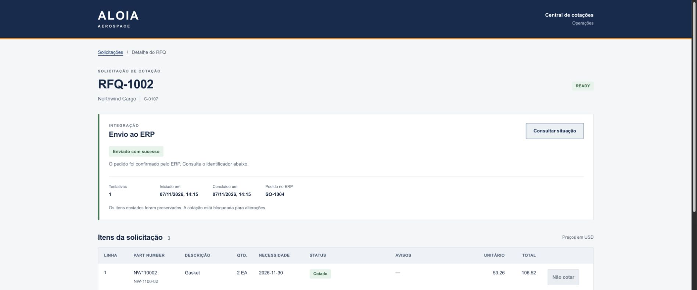
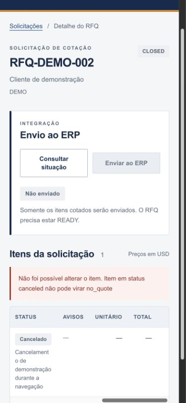
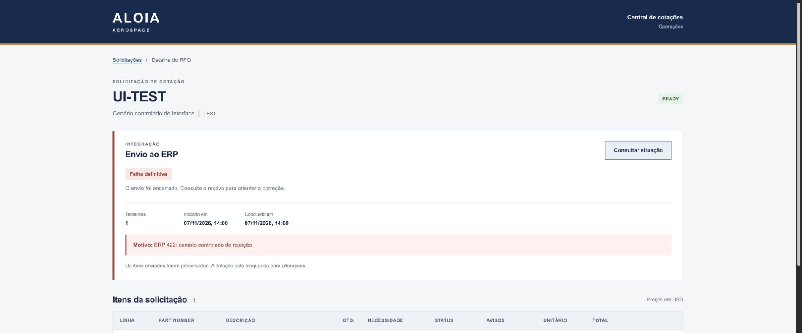

# Handoff — Aloia RFQ confiável

Data: 7 de novembro de 2026 · America/Sao_Paulo.

## Resultado e acesso local

Implementação funcional concluída e validada: cancelamento e eventos idempotentes, envio único
com reconciliação, validação/segurança/preços e interface Aloia com paginação, estados e feedback.
README, contexto de agente e Spec Kit estão versionados. **Branch completa publicada e verificada:**
`0f34a6300a8196552064a60eef8f9a7ba53f73ce` coincide com o remoto; o commit documental posterior
registra este encerramento, sem alterar o código validado.

- Interface: [http://127.0.0.1:5173/](http://127.0.0.1:5173/).
- Exemplo pronto para testar: [RFQ-DEMO-022](http://127.0.0.1:5173/#/rfqs/RFQ-DEMO-022), READY e ainda não enviado.
- Exemplo enviado pela interface: [RFQ-1002](http://127.0.0.1:5173/#/rfqs/RFQ-1002), pedido SO-1004.
- API: http://localhost:3000; exige chave inclusive em `/health`.
- ERP local existente: http://localhost:4001, confirmado em `chaos`. Esse override está somente no `.env` ignorado; padrão do README é 4000.
- API e Vite foram deixados em execução para teste. Foram preservados PostgreSQL, ERP, dados anteriores e worktrees.

O GitHub privado é [femedici/aloia-challenge-rfq](https://github.com/femedici/aloia-challenge-rfq),
branch `agent/aloia-rfq-reliability`. O template original privado não permite fork; foi criada
uma cópia privada com histórico integral e `upstream` preservado.

**Pendência externa:** o acesso de leitura de `leobaldoneto`, pedido pelo README original,
não foi concedido. GitHub não oferece papel read-only para colaboradores de repositório pessoal
privado; seria necessário destino em organização ou autorização para outra permissão.
Nenhum convite, transferência, acesso de escrita, merge remoto ou deploy foi realizado.
[Regra oficial do GitHub](https://docs.github.com/en/repositories/managing-your-repositorys-settings-and-features/repository-access-and-collaboration/permission-levels-for-a-personal-account-repository).

## Pedido original e pedido otimizado

Pedido inicial: “implement the following spec using my git and focusing the aloia repo”.
O anexo “spec - aloia test” pede uma cópia privada com histórico, implementação dos 14 requisitos
principais e 11 secundários, testes de sucesso/falha/concorrência, preservação da arquitetura,
UI inspirada na Aloia após a lógica validada, README, contexto corrigido e relatório com linhas e inventário.
O conteúdo corrigido, sem instruções de geração de documentos/repositório, está em `AGENT.md`.
O original permanece no anexo do chat; a referência técnica original `SPEC.md` foi preservada.

**Pedido otimizado:** implementar o contrato completo no Aloia, mantendo Nest/TypeORM/PostgreSQL
na API e React/Vite/TanStack Query na UI; usar Spec Kit 1.0.3 aprovado, concorrência garantida no
banco, snapshots e reconciliação para não duplicar pedidos; validar cada regra com cenários
pertinentes de sucesso e falha, revisar o resultado integrado, rodar localmente, documentar
cada requisito e publicar apenas a branch de trabalho com histórico preservado.

Autorizações: uso e inicialização do Spec Kit, constituição focada no anexo, arquitetura
PostgreSQL com `canceled` e registros separados de webhook/envio, implementação, commits e push.
Não foi solicitado PR neste projeto; nenhum foi aberto.

## Cada requisito: implementação e evidência

| Item | Implementação | Código | Verificação observada |
|---|---|---|---|
| P1 / FR-001 | Cancelamento terminal, inclusive antes da criação. | [src/rfq/rfq.service.ts:64](/Users/felipemedici/Documents/aloia-challenge-rfq/src/rfq/rfq.service.ts:64) | rfq-events: antes/depois, duplicação e bloqueio de cotação |
| P2 / FR-002 | Ledger permanente com claim único e timestamps na mesma transação. | [src/rfq/rfq.service.ts:30](/Users/felipemedici/Documents/aloia-challenge-rfq/src/rfq/rfq.service.ts:30); [src/rfq/rfq-event.entity.ts:1](/Users/felipemedici/Documents/aloia-challenge-rfq/src/rfq/rfq-event.entity.ts:1) | 10 entregas concorrentes, identidade global e rollback/redelivery |
| P3 / FR-003 | Primeira criação do RFQ prevalece, com constraint e lock. | [src/rfq/rfq.entity.ts:9](/Users/felipemedici/Documents/aloia-challenge-rfq/src/rfq/rfq.entity.ts:9); [src/rfq/rfq.service.ts:46](/Users/felipemedici/Documents/aloia-challenge-rfq/src/rfq/rfq.service.ts:46) | novo eventId não substitui cliente/itens; 10 criações simultâneas |
| P4 / FR-004 | Cancelamentos retidos e aplicados deterministicamente. | [src/rfq/rfq.service.ts:64](/Users/felipemedici/Documents/aloia-challenge-rfq/src/rfq/rfq.service.ts:64) | cancelamento antecipado; motivo por occurredAt/eventId |
| P5 / FR-005 | POST submit aceita nova submissão somente em READY. | [src/rfq/rfq.controller.ts:28](/Users/felipemedici/Documents/aloia-challenge-rfq/src/rfq/rfq.controller.ts:28); [src/rfq/rfq.service.ts:173](/Users/felipemedici/Documents/aloia-challenge-rfq/src/rfq/rfq.service.ts:173) | OPEN/IN_PROGRESS/INVALID/CLOSED→409; inexistente→404 |
| P6 / FR-006 | Snapshot contém somente quoted; detalhe mantém todos os itens. | [src/rfq/rfq.service.ts:185](/Users/felipemedici/Documents/aloia-challenge-rfq/src/rfq/rfq.service.ts:185) | payload misto conserva só linha 1; detalhe conserva 4; ERP real RFQ-1002 só linha 1 |
| P7 / FR-007 | Uma submissão por RFQ; intenção persistida antes da rede. | [src/erp/erp-submission.worker.ts:55](/Users/felipemedici/Documents/aloia-challenge-rfq/src/erp/erp-submission.worker.ts:55); [src/erp/rfq-submission.entity.ts:1](/Users/felipemedici/Documents/aloia-challenge-rfq/src/erp/rfq-submission.entity.ts:1) | workers concorrentes, queda/reinício, falha SQL e respostas perdidas |
| P8 / FR-008 | GET expõe sete estados, tentativas, timestamps, motivo e ID. | [src/rfq/rfq.service.ts:164](/Users/felipemedici/Documents/aloia-challenge-rfq/src/rfq/rfq.service.ts:164) | não enviado, ativo, sent e failed; sete rótulos vistos no navegador |
| P9 / FR-009 | 422 permanente; 429/503 retry; timeout só reconcilia. | [src/erp/erp-submission.worker.ts:85](/Users/felipemedici/Documents/aloia-challenge-rfq/src/erp/erp-submission.worker.ts:85); [src/erp/erp.client.ts:56](/Users/felipemedici/Documents/aloia-challenge-rfq/src/erp/erp.client.ts:56) | 42 testes ERP; chaos real com tentativas 1/2/3 e um pedido por RFQ |
| P10 / FR-010 | Botão READY, carregamento, motivo e repetição segura. | [web/src/RfqDetail.tsx:53](/Users/felipemedici/Documents/aloia-challenge-rfq/web/src/RfqDetail.tsx:53) | submit real→SO-1004; 503 simulado→retry utilizável; itens congelados |
| P11 / FR-011 | Polling de 2 segundos enquanto ativo ou incerto. | [web/src/RfqDetail.tsx:36](/Users/felipemedici/Documents/aloia-challenge-rfq/web/src/RfqDetail.tsx:36) | Aguardando envio→Enviado com sucesso sem refresh manual |
| P12 / FR-012 | Regressões de idempotência com banco e HTTP reais. | [test/rfq-events.test.ts:1](/Users/felipemedici/Documents/aloia-challenge-rfq/test/rfq-events.test.ts:1); [test/rfq-api.test.ts:1](/Users/felipemedici/Documents/aloia-challenge-rfq/test/rfq-api.test.ts:1); [test/erp-worker.test.ts:1](/Users/felipemedici/Documents/aloia-challenge-rfq/test/erp-worker.test.ts:1) | concorrência, redelivery, snapshots e no máximo um pedido no ERP, com retries seguros |
| P13 / FR-013 | X-Api-Key em todos os endpoints; HMAC permanece no webhook. | [src/common/api-key.guard.ts:1](/Users/felipemedici/Documents/aloia-challenge-rfq/src/common/api-key.guard.ts:1); [src/rfq/webhook.controller.ts:1](/Users/felipemedici/Documents/aloia-challenge-rfq/src/rfq/webhook.controller.ts:1) | matriz 401 de 7 rotas, chave errada de mesmo tamanho, assinatura forjada/corpo alterado |
| P14 / FR-014 | Problemas corrigidos e pendências com impacto/recomendação. | [README.md:189](/Users/felipemedici/Documents/aloia-challenge-rfq/README.md:189) | revisão do diff e seis riscos concretos registrados |
| S1 / FR-015 | Uma derivação de status para lista e detalhe. | [src/rfq/rfq.service.ts:135](/Users/felipemedici/Documents/aloia-challenge-rfq/src/rfq/rfq.service.ts:135); [src/rfq/rfq.controller.ts:22](/Users/felipemedici/Documents/aloia-challenge-rfq/src/rfq/rfq.controller.ts:22) | cinco estados; mistura pending+invalid mantém OPEN |
| S2 / FR-016 | Blacklist normalizada com a mesma função dos itens. | [src/common/normalize.ts:19](/Users/felipemedici/Documents/aloia-challenge-rfq/src/common/normalize.ts:19) | normalização positiva/negativa e bloqueio por HTTP |
| S3 / FR-017 | Data de calendário sem conversão de fuso. | [src/common/normalize.ts:26](/Users/felipemedici/Documents/aloia-challenge-rfq/src/common/normalize.ts:26) | datas reais, bissexto, datas inexistentes e fusos |
| S4 / FR-018 | BigInt/racional e half-up apenas ao final. | [src/common/price.ts:1](/Users/felipemedici/Documents/aloia-challenge-rfq/src/common/price.ts:1) | 35.51/106.53; 1.005→1.01; taxas/moq/encargos/limites |
| S5 / FR-019 | Validação de estrutura, campos, decimais e limites da linha. | [src/common/validation.ts:1](/Users/felipemedici/Documents/aloia-challenge-rfq/src/common/validation.ts:1) | ausentes/tipos errados/NUL/IDs extensos/rotas int32→400 |
| S6 / FR-020 | page positivo, pageSize de 1 a 100, offset seguro. | [src/common/validation.ts:103](/Users/felipemedici/Documents/aloia-challenge-rfq/src/common/validation.ts:103) | inválidos→400 e páginas disjuntas por HTTP |
| S7 / FR-021 | Paginações de 20 e retorno preservando página. | [web/src/RfqList.tsx:1](/Users/felipemedici/Documents/aloia-challenge-rfq/web/src/RfqList.tsx:1) | página 1 com 20, página 2 com 4; retorno do detalhe mantém página 2 |
| S8 / FR-022 | Mensagens, status textuais, regiões, foco e responsividade. | [web/src/RfqDetail.tsx:1](/Users/felipemedici/Documents/aloia-challenge-rfq/web/src/RfqDetail.tsx:1); [web/src/App.tsx:1](/Users/felipemedici/Documents/aloia-challenge-rfq/web/src/App.tsx:1); [web/src/styles.css:55](/Users/felipemedici/Documents/aloia-challenge-rfq/web/src/styles.css:55) | teclado Enter/foco main; no_quote sucesso; stale cancel 409; móvel sem overflow da página |
| S9 / FR-023 | Logs correlacionam evento/RFQ/tentativa/resultado. | [src/rfq/rfq.service.ts:40](/Users/felipemedici/Documents/aloia-challenge-rfq/src/rfq/rfq.service.ts:40); [src/erp/erp-submission.worker.ts:148](/Users/felipemedici/Documents/aloia-challenge-rfq/src/erp/erp-submission.worker.ts:148) | logs locais processed/duplicate/retry_wait/sent; segredo não vai no bundle |
| S10 / FR-024 | Configuração validada antes de aceitar requisições. | [src/common/config.ts:1](/Users/felipemedici/Documents/aloia-challenge-rfq/src/common/config.ts:1); [src/main.ts:8](/Users/felipemedici/Documents/aloia-challenge-rfq/src/main.ts:8) | configuração válida, ausência/branco, porta e URL inválidas |
| S11 / FR-025 | Testes de regressão pequenos e integração nas regras alteradas. | [test/domain.test.ts:1](/Users/felipemedici/Documents/aloia-challenge-rfq/test/domain.test.ts:1); [test/normalize.test.ts:1](/Users/felipemedici/Documents/aloia-challenge-rfq/test/normalize.test.ts:1); [test/rfq-api.test.ts:1](/Users/felipemedici/Documents/aloia-challenge-rfq/test/rfq-api.test.ts:1) | 290 testes/9 suítes; cobertura medida abaixo |
| FR-026 | Estética Aloia após core passar. | [web/src/styles.css:1](/Users/felipemedici/Documents/aloia-challenge-rfq/web/src/styles.css:1) | referência visual real consultada; navy/orange, CTA retangular, desktop/móvel |
| FR-027 | README com as seis seções exigidas. | [README.md:1](/Users/felipemedici/Documents/aloia-challenge-rfq/README.md:1) | instruções e comandos revisados; sintaxe bash validada |
| FR-028 | AGENT corrigido, handoff, linhas e inventário. | [AGENT.md:1](/Users/felipemedici/Documents/aloia-challenge-rfq/AGENT.md:1) | revisão contra os 14 itens principais e 11 secundários do anexo |

## Arquitetura e fluxo

1. Controller autentica chave e HMAC do corpo bruto; valida o payload.
2. Uma transação tenta inserir `eventId` único; duplicata é reconhecida sem reprocessar.
3. Advisory lock transacional por RFQ serializa criação, cancelamento, cotação e submit.
4. A primeira criação preserva dados originais/normalizados; o ledger recupera cancelamentos prévios.
5. Submit READY cria uma única linha com snapshot dos itens quoted, sem excluir itens históricos.
6. Worker lê linhas vencidas, adquire lock de sessão por RFQ e consulta o ERP.
7. Persiste intenção `sending` antes do POST. Só 429/503 autorizam retry do POST; resultado incerto
   permite apenas reconciliação. O GET expõe progresso commitado e a UI consulta a cada 2 segundos.

O snapshot é imutável. Cotação/no_quote ficam bloqueados após submit. Cancelamento posterior
continua local e não altera o pedido no ERP. Itens originalmente inválidos permanecem inválidos.
Em consulta permanentemente vazia após POST incerto, a segurança contra duplicatas sacrifica
recuperação automática; não há timeout que autorize repetir cegamente o pedido.

## Validação executada

| Comando ou cenário | Resultado |
|---|---|
| `npm test -- --runInBand --coverage --collectCoverageFrom='src/**/*.ts' --coverageReporters=text --coverageReporters=json-summary` | **290 testes, 9 suítes aprovadas**, PostgreSQL real em schemas temporários isolados. |
| `npm run build` | API compilou. |
| `npm --prefix web run build` | TypeScript e Vite compilaram após cada integração/fix da UI. |
| `npm run webhooks -- tudo` | Todos válidos/repetidos 200; assinatura inválida 401. Sem reset. |
| Upgrade legado populado | IDs, quantidade e preços preservados com migration antes de synchronize. |
| ERP HTTP controlado + PostgreSQL | 422/400/401 permanentes; 429/Retry-After; 503; demora/resposta perdida; JSON inválido; reinício; falhas SQL; locks e shutdown. |
| ERP real em chaos | RFQ-DEMO-019/020/021 chegaram a sent com 1/2/3 tentativas e exatamente 1 pedido por RFQ. |
| UI→API→ERP real | RFQ-1002 passou de pendente a enviado automaticamente, SO-1004, somente linha 1 no ERP. |
| Navegação/ações | Página 2 com 4 registros; retorno preserva página; teclado Enter/foco main; OPEN/CLOSED sem submit; no_quote sucesso e stale cancel 409 visíveis. |
| UI com respostas controladas | Todos os 7 estados exibidos; 503 antes de aceite mantém retry utilizável; failed mostra motivo; retries e reconciliação exibem próxima execução. Fixture HTTP temporária sem acesso a banco/ERP, encerrada após o teste. |
| Responsividade | Desktop e viewport 390×844; largura útil 375px e scrollWidth 375px após correção do rótulo oculto; apenas tabela rola horizontalmente. |
| Segurança do bundle | Verificação sem valores secretos no JavaScript/CSS gerado; a chave fica no proxy Vite. |
| Documentação | Sintaxe bash do README validada; links locais e linhas conferidos. |
| Convergência Spec Kit | 28 requisitos, 25 cenários de aceite, 5 critérios de sucesso, 8 decisões de arquitetura e 5 princípios conferidos; nenhuma lacuna missing/partial/contradicts/unrequested e nenhuma tarefa corretiva nova. |
| Publicação | Commit completo 0f34a63 confere com origin; histórico original preservado; 62 arquivos novos incluídos e árvore limpa antes do encerramento documental. |

Cobertura backend medida: **96,52% das linhas, 95,85% das instruções, 97% dos ramos e 95,65% das funções**.
RFQ e ERP: **100% das linhas**; normalização, preços e validação: **100% de linhas/ramos/funções**.
RFQ: 100% dos ramos; ERP: 92,77% dos ramos. Os módulos de bootstrap `main.ts`/`app.module.ts`
foram exercitados pelo smoke local, mas não instrumentados pelo Jest; o bloqueio de downgrade
da migration também não foi executado. Alguns ramos defensivos do ERP permanecem fora da
cobertura automatizada. A UI teve build e testes reais/manuais de navegador, sem métrica Jest de frontend.
Não se afirma 100% de cobertura global nem prova absoluta de correção.







## Tarefas e estado para retomada

O tracker único é `specs/001-aloia-rfq-reliability/tasks.md`.
T001–T010: concluídas, integradas e verificadas pelo coordenador, incluindo convergência,
documentação e publicação da branch. Nenhum trabalho de implementação pendente conhecido.
Permanece apenas a decisão externa sobre o acesso do avaliador, descrita no início deste arquivo.
Dependências: T002/T003/T005 paralelas; T004/T006 integram; T007 depois do core; T008→T009→T010.

Agentes: root coordenou e integrou; domain_rules implementou domínio e depois UI em outra worktree;
erp_delivery implementou ERP e depois README em outra worktree; audit_rfq_architecture revisou sem editar.
Revisões geraram correções verificadas de migration, autenticação negativa, limites de rota/404,
recuperação de submit incerto, foco de navegação e overflow móvel.

## Inventário de tabelas, entidades e endpoints

| Novo elemento | Finalidade |
|---|---|
| `rfq_event` / `RfqEventRecord` | Idempotência global, payload e timestamps de eventos/cancelamentos. |
| `rfq_submission` / `RfqSubmission` | Um snapshot e ciclo de envio por RFQ, tentativas, datas, ID e erro. |
| `migrations` / metadados TypeORM | Tabela técnica que registra a execução da conversão preservadora de quantity; não é entidade de negócio. |
| `POST /rfqs/:rfqId/submit` | Único endpoint novo da aplicação. 202 ativo/200 terminal; 409 novo envio fora de READY. |

`rfq.item_canceled` é um tipo novo no endpoint existente de webhook, não uma rota nova.
Entidades existentes alteradas: `Rfq` ganha unicidade de rfqId; `RfqItem` ganha unicidade de linha
por RFQ, cancellationReason e quantity double precision. `GET /rfqs/:rfqId` ganha submission;
lista e mutações mantêm rotas existentes. Não foram adicionadas dependências de runtime.

## Arquivos novos

Lista completa relativa à raiz; inclui scaffold Spec Kit 1.0.3 autorizado e artefatos de evidência.

- `.agents/skills/speckit-analyze/SKILL.md`
- `.agents/skills/speckit-checklist/SKILL.md`
- `.agents/skills/speckit-clarify/SKILL.md`
- `.agents/skills/speckit-constitution/SKILL.md`
- `.agents/skills/speckit-converge/SKILL.md`
- `.agents/skills/speckit-implement/SKILL.md`
- `.agents/skills/speckit-plan/SKILL.md`
- `.agents/skills/speckit-specify/SKILL.md`
- `.agents/skills/speckit-tasks/SKILL.md`
- `.agents/skills/speckit-taskstoissues/SKILL.md`
- `.specify/.gitignore`
- `.specify/init-options.json`
- `.specify/integration.json`
- `.specify/integrations/codex.manifest.json`
- `.specify/integrations/speckit.manifest.json`
- `.specify/memory/.constitution-template.json`
- `.specify/memory/constitution.md`
- `.specify/scripts/bash/check-prerequisites.sh`
- `.specify/scripts/bash/common.sh`
- `.specify/scripts/bash/create-new-feature.sh`
- `.specify/scripts/bash/resolve-template.sh`
- `.specify/scripts/bash/setup-plan.sh`
- `.specify/scripts/bash/setup-tasks.sh`
- `.specify/templates/checklist-template.md`
- `.specify/templates/constitution-template.md`
- `.specify/templates/plan-template.md`
- `.specify/templates/spec-template.md`
- `.specify/templates/tasks-template.md`
- `.specify/workflows/speckit/workflow.yml`
- `.specify/workflows/workflow-registry.json`
- `AGENT.md`
- `docs/plans/2026-11-07-aloia-rfq-design.md`
- `outputs/aloia-rfq-failure.png`
- `outputs/aloia-rfq-handoff.md`
- `outputs/aloia-rfq-mobile.png`
- `outputs/aloia-rfq-ui.png`
- `specs/001-aloia-rfq-reliability/checklists/requirements.md`
- `specs/001-aloia-rfq-reliability/contracts/api.md`
- `specs/001-aloia-rfq-reliability/data-model.md`
- `specs/001-aloia-rfq-reliability/plan.md`
- `specs/001-aloia-rfq-reliability/quickstart.md`
- `specs/001-aloia-rfq-reliability/research.md`
- `specs/001-aloia-rfq-reliability/spec.md`
- `specs/001-aloia-rfq-reliability/tasks.md`
- `src/common/config.ts`
- `src/common/price.ts`
- `src/common/validation.ts`
- `src/erp/erp-submission.worker.ts`
- `src/erp/rfq-submission.entity.ts`
- `src/migrations/1794000000000-preserve-rfq-quantity.ts`
- `src/rfq/rfq-event.entity.ts`
- `src/rfq/rfq.types.ts`
- `test/config.test.ts`
- `test/database.ts`
- `test/domain.test.ts`
- `test/erp-client.test.ts`
- `test/erp-database.ts`
- `test/erp-worker.test.ts`
- `test/migration.test.ts`
- `test/rfq-api.test.ts`
- `test/rfq-events.test.ts`
- `test/security.test.ts`

## Arquivos existentes alterados

- `README.md`
- `scripts/send-webhooks.mjs`
- `src/app.module.ts`
- `src/common/api-key.guard.ts`
- `src/common/normalize.ts`
- `src/erp/erp.client.ts`
- `src/erp/erp.module.ts`
- `src/health/health.controller.ts`
- `src/main.ts`
- `src/rfq/items.controller.ts`
- `src/rfq/rfq-item.entity.ts`
- `src/rfq/rfq.controller.ts`
- `src/rfq/rfq.entity.ts`
- `src/rfq/rfq.module.ts`
- `src/rfq/rfq.service.ts`
- `src/rfq/webhook.controller.ts`
- `test/normalize.test.ts`
- `web/index.html`
- `web/src/App.tsx`
- `web/src/RfqDetail.tsx`
- `web/src/RfqList.tsx`
- `web/src/api.ts`
- `web/src/styles.css`

## Git e worktrees preservadas

Base original: `2e810cf1d1def232ffd086a63fb2d14b81b1e5d6`.
`origin`: git@github.com:femedici/aloia-challenge-rfq.git.
`upstream`: git@github.com:AloiaAerospace/aloia-challenge-rfq.git.
Somente a branch integrada foi publicada. Branches auxiliares permanecem locais.
As worktrees abaixo foram preservadas; consulte `git worktree list` para seus HEADs atuais.

```text
/Users/felipemedici/Documents/aloia-challenge-rfq [agent/aloia-rfq-reliability]
/Users/felipemedici/.codex/worktrees/aloia-documentation/aloia-challenge-rfq [agent/aloia-documentation]
/Users/felipemedici/.codex/worktrees/aloia-domain-rules/aloia-challenge-rfq [agent/aloia-domain-rules]
/Users/felipemedici/.codex/worktrees/aloia-erp-delivery/aloia-challenge-rfq [agent/aloia-erp-delivery]
/Users/felipemedici/.codex/worktrees/aloia-rfq-ui/aloia-challenge-rfq [agent/aloia-rfq-ui]
```

## Riscos, limites e ações não autorizadas

- Não apagar ledger/submissões nem resetar/reiniciar ERP para “corrigir” reconciliação. O simulador
  mantém pedidos em memória; perder esse histórico impede confirmar resultados antigos.
- Synchronize permanece herdado. Para produção, usar migrations completas, backup e revisão de
  duplicatas legadas; não deduplicar dados do usuário automaticamente.
- Proxy Vite é para desenvolvimento: qualquer pessoa com acesso ao proxy usa a chave injetada.
  API/Compose podem escutar outras interfaces; não publicar esse ambiente sem proteção adequada.
- Health atual é liveness; não comprova banco/ERP prontos. A verificação desta entrega usou consultas
  reais ao banco e ao ERP, além do navegador.
- Sem login, cancelamento/alteração no ERP, múltiplos fornecedores, broker ou deploy: fora do escopo.
- Sem limpeza de branches/worktrees, force push, mudança de proteções, convite ou merge automático.
- Falhas/retries permanentes e armazenamento do ledger precisam de observabilidade/retenção numa implantação.
- Acesso do avaliador exige decisão separada; não ampliar de leitura para escrita silenciosamente.

## Como continuar sem o histórico do chat

1. Abrir `/Users/felipemedici/Documents/aloia-challenge-rfq`; conferir `git status` e branch antes de editar.
2. Ler `AGENT.md`, spec viva, contratos e tracker; preservar `.env` e dados existentes.
3. Usar os comandos do README. Os serviços locais desta entrega são API 3000, Vite 5173 e ERP 4001.
4. Para testar um envio novo agora, abrir RFQ-DEMO-022. Depois de enviado, repetições retornam o
   resultado existente. Para outro ciclo, criar novos IDs de RFQ/evento; nunca limpar histórico.
5. Para mudanças na mesma feature, atualizar spec e tasks e repetir validação pertinente.
6. Resolver acesso de leitura do avaliador somente com decisão explícita do usuário; não assumir
   autorização para transferência ou acesso de escrita.

Segredos não estão neste documento. Evidências de teste não usam dados de clientes reais;
RFQ-DEMO-* são cenários locais identificados e os fixtures originais foram preservados.
